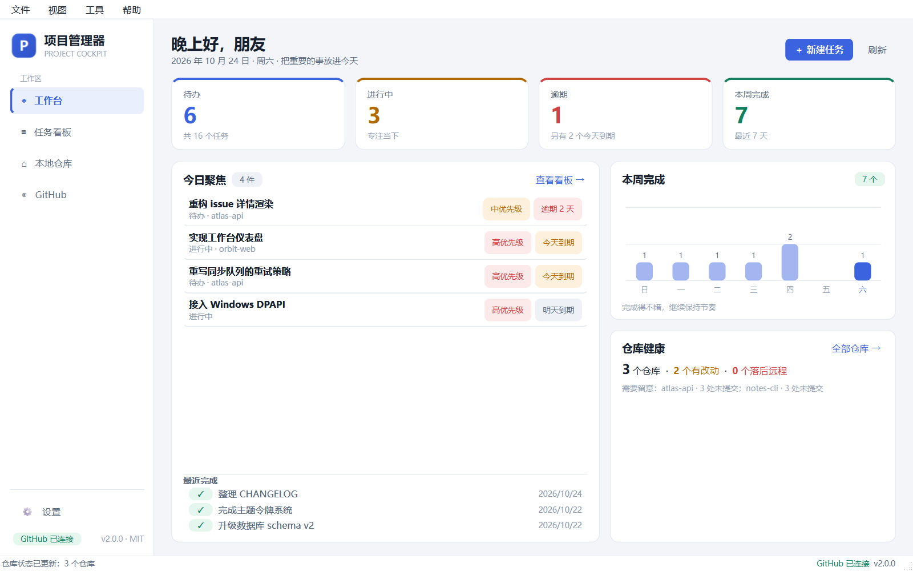
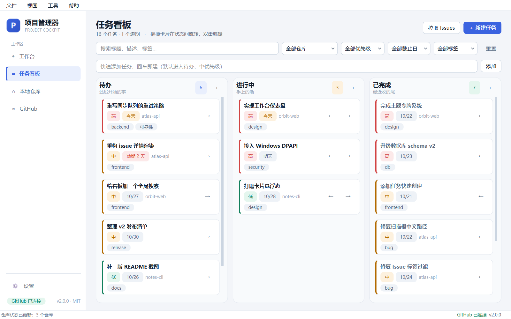
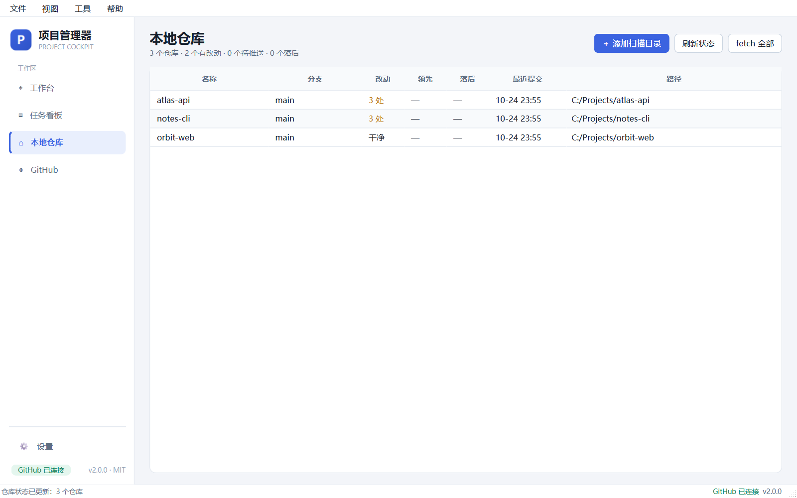
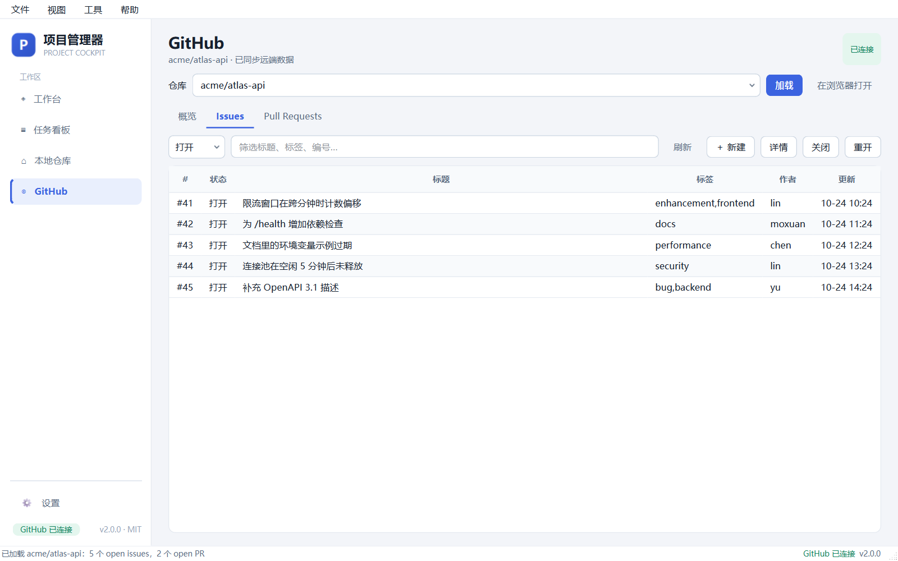
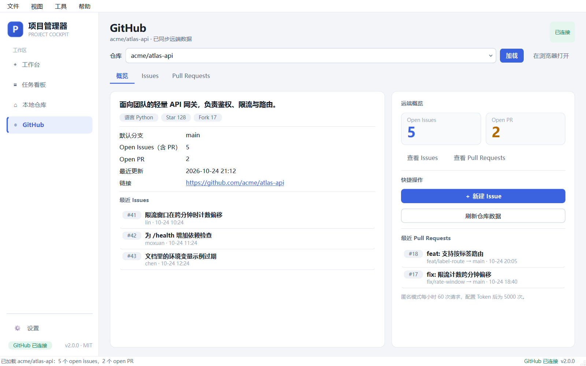
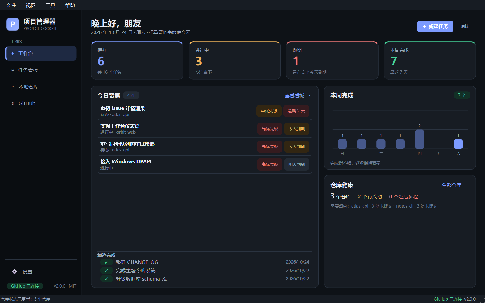
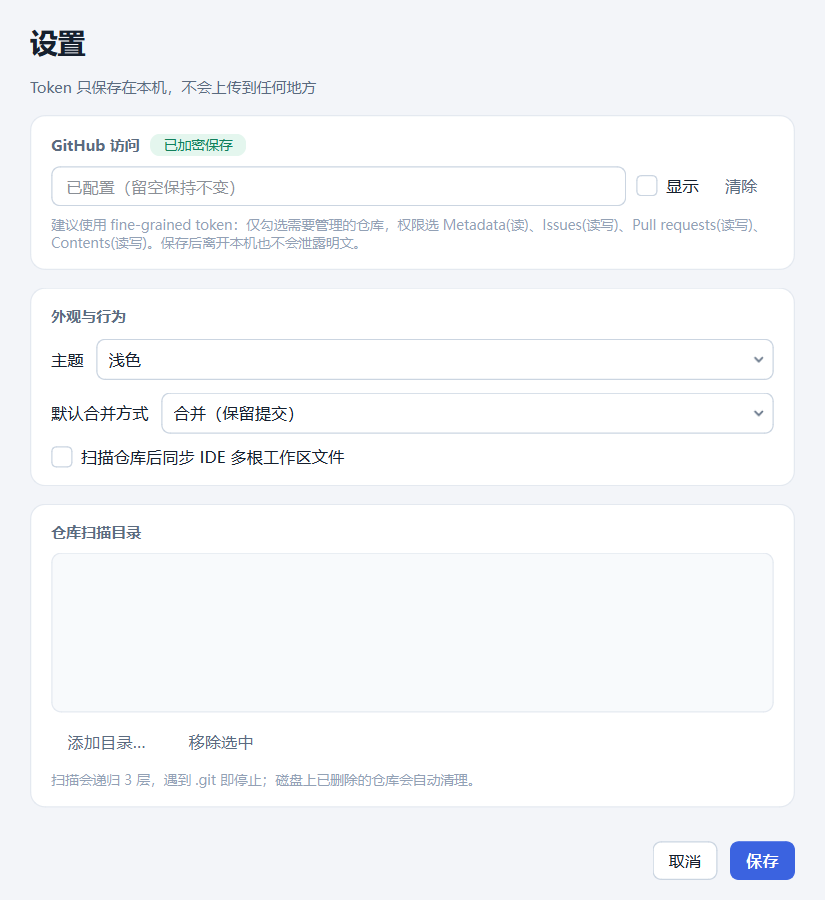

# 项目管理器 · Project Cockpit

把「今天做什么」「代码写到哪了」「远端等我处理什么」收进一个窗口。

本地任务看板 + git 仓库状态 + GitHub Issues/PR 的一体化桌面工作台（PySide6）。



## v2 亮点

- **工作台**：待办 / 进行中 / 逾期 / 本周完成一屏掌握，聚焦今天，7 日完成趋势，仓库健康摘要
- **任务看板**：搜索 + 仓库/优先级/截止日/标签筛选，回车快速添加，跨列拖拽，双击编辑
- **本地仓库**：改动数 / 领先 / 落后 / 最近提交，一键 fetch、`pull --ff-only`、终端 / VS Code 打开
- **GitHub**：本地仓库直接跳转，Issue 详情与评论流、新建 / 关闭 / 重开、PR 详情与合并
- **看得舒服**：统一设计令牌，浅色 / 深色 / 跟随系统随时切换
- **数据安全**：GitHub Token 用 Windows DPAPI 加密，不再明文落盘；数据库升级前自动备份
- **工程质量**：20 个 pytest 用例、单实例锁、滚动日志、崩溃堆栈落盘、环境变量隔离测试数据

## 界面

### 任务看板



筛选与搜索即时生效；卡片左侧色条表示优先级，`←` / `→` 按钮和拖拽都能改变状态。

### 本地仓库



右键可以打开终端、VS Code、资源管理器，或直接 `pull --ff-only`。状态读取全部在后台线程完成，界面不卡。

### GitHub





双击 Issue 查看正文与评论，可在详情里直接评论 / 关闭 / 重开。概览页汇总远端数据并支持一键新建 Issue。

### 深色模式



### 设置



Token 输入框留空即保持不变；「清除」并保存可移除。已配置的 Token 只显示状态，不回显明文。

## 快捷键

| 快捷键 | 作用 |
| --- | --- |
| `Ctrl+1` ~ `Ctrl+4` | 工作台 / 看板 / 仓库 / GitHub |
| `Ctrl+N` | 新建任务 |
| `Ctrl+K` | 聚焦看板搜索 |
| `Ctrl+E` | 导出任务 CSV |
| `F5` | 刷新当前页 |
| `Ctrl+,` | 设置 |
| `Ctrl+Q` | 退出 |

## 数据与隐私

- **数据库**：`%LOCALAPPDATA%\ProjectManager\pm.db`（SQLite，短连接 + 参数化 SQL）
- **Token**：项目根 `.env` 中的 `GITHUB_TOKEN_DPAPI`，由 Windows DPAPI 按当前用户加密；换机器 / 换 Windows 账户后需重新填写。旧版明文 Token 与数据库旧值会在首次读取时自动迁移并抹掉
- **备份**：`%LOCALAPPDATA%\ProjectManager\backups\`，升级 schema 前强制快照，日常启动最多每天一次，保留 10 份
- **日志**：`%LOCALAPPDATA%\ProjectManager\app.log`（滚动 3 份），未捕获异常也会落盘
- **IDE 工作区**：扫描后同步 `~/Desktop/日常维护.code-workspace`，可在设置里关闭
- **单实例**：`%LOCALAPPDATA%\ProjectManager\app.lock`，避免两个窗口同时写库
- 所有网络请求只发往 GitHub API；无遥测、无上传

> 截图中的 `acme/*` 仓库、Issues 与任务均为演示数据，由 `scripts/screenshots.py` 在临时目录生成，不包含个人数据。

## 运行

需要 Python 3.10+、系统 git。

```bash
python -m venv .venv
.venv\Scripts\activate
pip install -r requirements.txt
python main.py
```

也可以双击 `启动项目管理器.bat`（使用 `pythonw` 无控制台启动）。

首次使用在「设置」里填写 GitHub Token（[点此生成](https://github.com/settings/tokens)）。建议 fine-grained token，只授权需要管理的仓库，权限选 Metadata(读) + Issues(读写) + Pull requests(读写) + Contents(读写)。

## 开发

```bash
pip install -r requirements-dev.txt
pytest                  # 服务层 / 迁移 / 加密 / 后台线程 / UI 冒烟
ruff check app tests scripts main.py
python scripts/screenshots.py   # 生成 docs/screenshots（临时演示库，不碰真实数据）
```

测试与截图都通过 `PM_DATA_DIR` / `PM_ENV_FILE` 指向临时目录；`PM_SYNC_WORKSPACE=0` 可禁止改写 IDE 工作区文件。

```
app/
├── constants.py          # 版本、数据路径、枚举、设置键
├── core/                 # db 迁移 / 备份 / DPAPI / 日志 / 线程 / 桌面 shell
├── models/               # Task / LocalRepo / RepoStatus
├── services/             # 任务、仓库、GitHub、统计、导出、同步
└── ui/
    ├── theme.py          # 设计令牌 + 全局 QSS + 调色板
    ├── brand.py          # 运行时绘制的应用图标
    ├── main_window.py    # 侧边栏 + 页面栈 + 菜单 / 快捷键
    ├── tabs/             # 工作台 / 看板 / 仓库 / GitHub
    ├── dialogs/          # 任务 / 仓库 / 设置 / Issue / PR / 关于
    └── widgets/          # 任务卡片、统计卡、迷你柱状图、页头
```

分层约定：UI 只调 services；跨页面通信走信号；GitHub / 扫描 / git 状态一律进线程池。

## 技术栈

Python 3.10+ · PySide6（Essentials）· PyGithub · GitPython · SQLite · truststore（Windows 系统证书链）

## License

[MIT](LICENSE)
